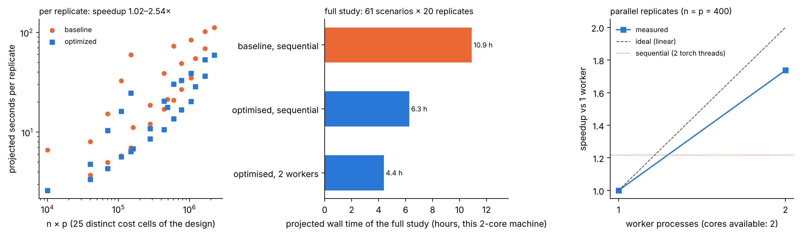
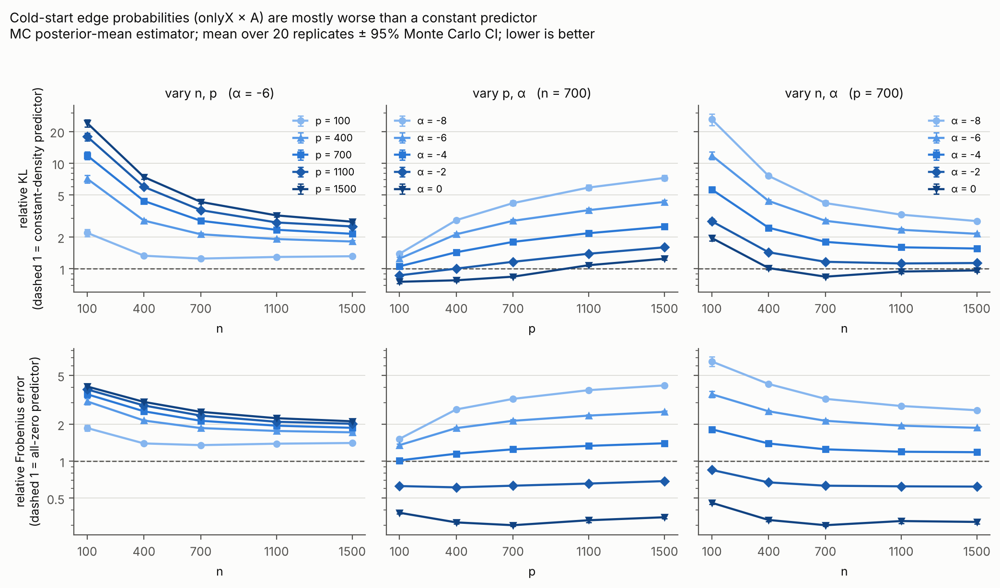

# Cold-start edge-probability recovery with a graph VAE: a high-performance simulation study

STATS 607 **Unit 3** project: profiling and optimising the Unit 2 simulation study.
The Unit 2 code is frozen in `src/baseline/`; the optimised code is in `src/`.

| Unit 3 document | content |
|---|---|
| [`docs/BASELINE.md`](docs/BASELINE.md) | baseline runtime, profiler results, complexity, numerical warnings |
| [`docs/OPTIMIZATION.md`](docs/OPTIMIZATION.md) | each optimisation: problem, before/after code, impact, trade-offs; regression evidence; lessons |
| [`docs/EXTENSIONS.md`](docs/EXTENSIONS.md) | simulation-budget analysis (how many replicates each scenario needs) |

```bash
make profile          # cProfile + pyinstrument of a representative replicate (n = p = 700)
make complexity       # timing vs n and vs p, baseline vs optimised, log-log fits   (~10 min)
make benchmark        # per-scenario + full-study projection + parallel speedup       (~12 min)
make parallel JOBS=8  # run the full study with the optimised code on 8 worker processes
make stability-check  # warnings / non-finite values / convergence across conditions  (~3 min)
make test             # all 35 tests, including tests/test_regression.py              (~2 min)
```



The rest of this README describes the study itself (unchanged from Unit 2).

---

STATS 607 Unit 2 project (Option B, original simulation).

A VAE with a GCN encoder and an inner-product edge decoder is trained on a partially
observed network: some nodes have edges only, some have edges and features, and 30% have
**features only** (cold-start nodes). The data come from a latent-position model,
P = σ(α + ZZᵀ), so the true edge probabilities are known. The study measures how well the
fitted model recovers P for cold-start × network pairs. It varies the number of nodes n,
the feature dimension p and the sparsity α (61 scenarios × 20 replicates), and compares a
plug-in estimator with a Monte Carlo posterior-mean estimator.
The full design is in [`ADEMP.md`](ADEMP.md) and the discussion in [`ANALYSIS.md`](ANALYSIS.md).

## Key findings

At the final training iteration, the cold-start probability estimates are **worse than a
constant predictor that knows only the edge density** in 53 of 61 scenarios. Error grows with the
feature dimension p and shrinks with n and density. The cold-start error is lowest after
roughly 50–100 iterations and then rises roughly twofold while in-network accuracy keeps
improving. MC averaging helps most where the plug-in estimate is worst, but it is slightly worse in sparse, low-p settings.



## Setup

```bash
git clone <this repo> && cd simulation-study
python -m venv .venv && source .venv/bin/activate   # Python >= 3.10
pip install -r requirements.txt
```

## Running

```bash
make all        # simulate (reuses cache) -> analyze -> figures
make test       # unit + regression tests (DGP, metrics, estimator, reproducibility, fidelity, optimised = baseline)
make help       # list all targets
```

| Target | What it does |
|---|---|
| `make simulate` | runs every scenario that is **not** already cached in `results/raw/sensitivity_results_prob30_zvar1/` (`python simulate.py --force` reruns everything) |
| `make simulate-quick` | tiny 7-scenario smoke test (`SIM_QUICK=1`), written to a separate `_quick` folder |
| `make analyze` | raw pickles → `results/summary.csv` (mean, SD, MCSE, 95% CI), `final_reps.csv`, `paired_mc_vs_pi.csv`, `trajectories.csv`, `design.csv`, `key_numbers.json` |
| `make figures` | `results/figures/fig1–fig4` (PDF + PNG) |
| `make clean` | removes all derived tables/figures; **keeps** the raw simulation cache |
| `make clean-raw` | also deletes the raw cache, so the next `make all` reruns the full simulation |

### Estimated runtime

* `make all` with the shipped cache (analysis + figures only): **about 15 s** on a laptop CPU.
* `make test`: **about 5 s**.
* Full simulation from scratch (`make clean-raw all`): 61 scenarios × 20 replicates × 1,200 full-batch
  iterations, each with O(n²) decoder work. A rough estimate is several hours on CPU, so it is meant for a cluster.
  The shipped results were produced on the UMich Great Lakes cluster.
  Unit 3 projects about 11 h sequentially on a 2-core machine for the baseline and 4.4 h for the optimised parallel code (docs/BASELINE.md, docs/OPTIMIZATION.md).

## Repository layout

```
simulation-study/
├── docs/                # Unit 3: BASELINE.md, OPTIMIZATION.md, EXTENSIONS.md
├── scripts/             # Unit 3: profile_run.py, complexity.py, benchmark.py, stability_check.py
├── src/
│   ├── baseline/        # Unit 2 code, frozen (reference for benchmarks and regression tests)
│   ├── perf.py          # Unit 3: component timing helpers
│   ├── config.py        # every parameter (DGP, split, model, evaluation, grid, seeds)
│   ├── dgps.py          # latent-position network + nonlinear binary features, node split
│   ├── methods.py       # preprocessing, VAE, training loop, plug-in and MC estimators
│   ├── metrics.py       # relative Frobenius / KL metrics, evaluation blocks
│   └── simulation.py    # scenario grid, replicate loop, logging, caching
├── simulate.py  analyze.py  figures.py   # entry points used by the Makefile
├── results/
│   ├── raw/sensitivity_results_prob30_zvar1/   # cached raw output: one .pkl (+ .txt) per scenario
│   ├── figures/                                # fig1–fig4
│   └── *.csv, key_numbers.json                 # summaries
├── tests/               # pytest suite
├── legacy/              # the original single-file server script and its two figures (provenance)
├── data/simulated/      # unused: replicates are regenerated from seeds, not stored
├── ADEMP.md  ANALYSIS.md  Makefile  requirements.txt
```

Figures: **fig1** (publication) cold-start accuracy across the three design slices with 95% MC CIs ·
**fig2** (diagnostic) per-block error and posterior log-variance over training ·
**fig3** paired MC − plug-in difference · **fig4** n × p heatmap at α = −6.

## Reproducibility

* Replicate *r* uses seed 42 + *r* for Z and A, 42 + *r* + 1000 for X, and 42 + *r* + 100 for the node split
  (NumPy `RandomState`). These seeds are identical in every scenario (common random numbers).
* The refactored code also calls `torch.manual_seed(42 + r)` before each fit. **The cached results
  were produced by `legacy/simulation_sensitivity_fix1_prob.py`, which did not seed torch.** The data,
  splits and model are identical, but weight initialisation, the reparameterisation noise and the MC draws
  are not. A rerun therefore reproduces the cached results in distribution, and individual replicate values
  will differ slightly. On CPU, the
  refactored pipeline is bit-for-bit deterministic. `tests/test_simulation.py::test_refactor_reproduces_original_script_exactly`
  runs the legacy script and the refactor with the same torch seed and checks that every logged metric matches.
* Progress is logged per replicate (Python `logging`, plus `tqdm` bars). Raw results are saved per scenario
  before any summarisation, so an interrupted run resumes where it stopped.
