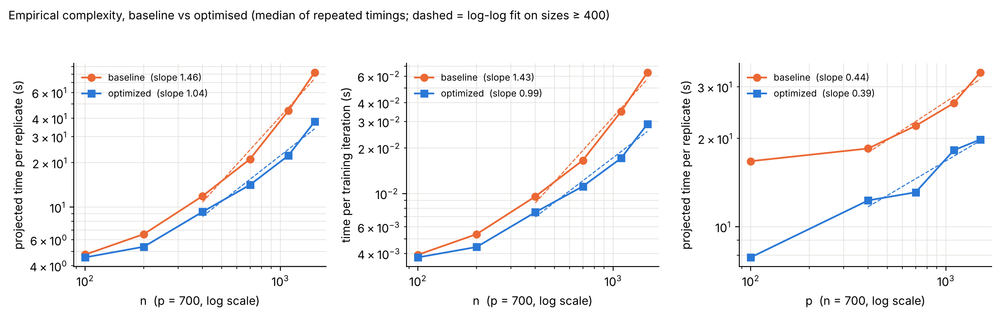

# Baseline performance (Unit 2 code)

The baseline is the code submitted for Unit 2, frozen in `src/baseline/`.
`tests/test_simulation.py` checks that it reproduces the original server script exactly.
Component timings are reported as medians of repeated runs taken after a warm-up call.

## Total runtime of the study

The Unit 2 study is 61 scenarios × 20 replicates × 1,200 full-batch training iterations,
with 25 metric evaluations and one 50-draw MC estimate per replicate.

| | value |
|---|---|
| actual sequential full-study runtime, 2-core benchmark machine | 10.9 h |
| cheapest replicate (n = 100, p = 100; reported timing range) | about 4–7 s |
| most expensive replicate (n = 1500, p = 1500) | 112 s |
| actual full-replicate runtime, n = p = 400 | 8.4 s |

The n = p = 400 row uses the existing end-to-end measurement.

## Profiler results

`make profile`: cProfile and pyinstrument on one representative replicate (n = p = 700, α = −6, 300
iterations, after warm-up). The full output is in `results/perf/profile_baseline.txt` and
`results/perf/profile_baseline.html`.

| function (self time unless noted) | seconds | share of 5.85 s |
|---|---:|---:|
| autograd backward (`run_backward`) | 2.07 | 35% |
| `VAE.Q`, the encoder (self) | 1.00 | 17% |
| `neg_elbo` (cumulative; 0.50 s self, mostly the boolean upper-triangle gather) | 0.88 | 15% |
| `evaluate` (cumulative, 7 calls; includes MC 0.40 s) | 0.69 | 12% |
| `binary_cross_entropy_with_logits` | 0.30 | 5% |
| `VAE.PX` + `VAE.PA` (cumulative) | 0.58 | 10% |
| `torch.sigmoid` (600 calls: probabilities returned by PX/PA but **never used**) | 0.17 | 3% |
| Adam update | 0.28 | 5% |

The pyinstrument tree (`results/perf/pyinstrument_baseline.txt`) shows the same picture. Everything
except data generation runs inside `fit_vae`; the metric evaluations are callbacks from the training loop.
Within training, the encoder's self time is the dense GCN products. Backward is dominated by the
X decoder and the first encoder layer.

## Computational complexity

**Theory.** Write n_A = 0.7n (network-observed nodes), n_X = 0.7n (nodes with features),
h = 128 (hidden width) and d = 8. One baseline iteration costs

| step | cost |
|---|---|
| `AHat @ X_A` (recomputed every iteration although constant) | O(n_A² p) |
| GCN propagation `AHat @ h_A` (computed twice) | O(n_A² h) |
| encoder first layer, X decoder (forward + backward) | O(n p h) |
| edge decoder z zᵀ on all n² pairs + unused sigmoid | O(n² d) |
| BCE terms | O(n_X p + n_A²) |

That is **O(n²(p + h) + n p h)** per iteration, × 1,200. Per replicate, add evaluation, 25 × O(n² d),
the MC estimator, 50 × O(n² d), and the preprocessing, O(n_A³), because diagonal scalings were written as
dense `np.diag(·) @ A` products. The DGP costs O(n² d + n h p). At the design's sizes (n, p ≤ 1500, h = 128),
the n²p term is the leading one once n ≳ h/0.49 ≈ 260.

**Empirical** (`make complexity`, `results/perf/complexity.csv`). Log-log slopes are fitted on sizes ≥ 400:

| component | slope in n (p = 700) | slope in p (n = 700) |
|---|---:|---:|
| training iteration | 1.43 | 0.47 |
| evaluation call | 1.99 | ≈ 0 |
| MC estimator | 2.00 | ≈ 0 |
| preprocessing | 2.68 | — |
| full replicate | 1.46 | 0.44 |

The pending full-replicate slopes must be fitted to measured end-to-end runtimes at the
same sizes, not to a sum of projected component costs. The component slopes above are retained.

The slopes are below the asymptotic exponents. At these sizes a sizeable part of each iteration is
fixed per-call overhead (about 4 ms at n = 100: Python, autograd bookkeeping, Adam's per-tensor loop).
The curvature in the figure shows the slope still rising with n, as the n²p term takes over.
Preprocessing shows its cubic term (slope 2.7) but is negligible in absolute terms.

## Numerical warnings and convergence

`make stability-check` → `results/perf/stability_report.md`:

* **RuntimeWarning: overflow encountered in exp** (DGP). The X generator's float32 logits reach −145,
  and the naive `1/(1+exp(−x))` overflows below −88.7. This happens in **262 of 1,220 replicates
  (21.5%), in all 61 scenarios**: it depends on the random generator weights, not on the scenario.
  The result is still the correct limit, 0, so the data are not wrong, but a warning in a quarter
  of the replicates hides any warning that matters. Fixed in Unit 3 (OPTIMIZATION §5) with bit-identical output.
* **NaN metrics.** 3 of 1,220 replicates (all in n = 100, p = 700, α = −8) have NaN `relfro_avg` in the
  onlyX × onlyA and onlyX × both sub-blocks. No row reaches expected degree 1, so the average is
  over an empty set. This is by design, and it is why `n_reps` is 18–19 for that metric in `summary.csv`.
  No primary metric is ever non-finite.
* **No NaN/inf losses**, and no training divergence. Rerunning the most extreme conditions with every
  warning turned into an error passed: n = 100 with p ∈ {100, 1500} and α ∈ {−8, 0}, plus n = 400, p = 1500, α = −8.
* **Loss is not monotone at the end.** Over the last 100 iterations the median relative decrease is
  1.1e-3, but the loss *rose* in 376 of 1,220 replicates. That is expected, because the logged loss is a
  one-sample ELBO estimate whose Monte Carlo noise is comparable to the remaining decrease. I read this
  as "optimisation has plateaued", not as divergence. The real convergence issue is statistical: the cold-start
  error is lowest after 50–100 iterations and then worsens (Unit 2, ANALYSIS.md).
* **Posterior log-variance** stays within [−6.2, 0.8] on average. Element-wise, |log σ²| reaches about 12
  at n = 400, p = 1500. That is far from float32 overflow of `exp` (88.7), but there is no explicit guard.
* **Degenerate graph structure at small n and sparse α.** At n = 100, α = −8, up to 63% of observed nodes
  are isolated and 73% of onlyA nodes have no 'both' neighbour, so their features fall back to the global
  mean. This is not a floating-point issue, but it explains why that corner of the design behaves differently.
