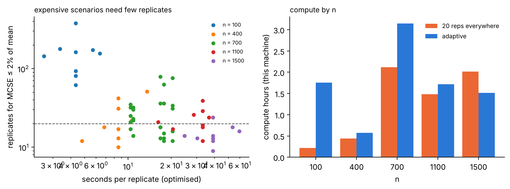

# Extension: simulation budget optimisation

**Question.** Unit 2 used R = 20 replicates in every scenario. Replicates differ hugely in cost
(about 4 s at n = 100 against about 60 s at n = p = 1500 with the optimised code) and in variance. Is the equal
allocation sensible, and what allocation would reach a fixed precision?

**Method** (`make extensions` → `scripts/budget.py`, `results/perf/budget*.{csv,json}`). I treat
the cached Unit 2 results as a pilot study. For the primary metric (MC relative KL, onlyX × A), the
target is a Monte Carlo SE of at most 2% of the mean, which gives a 95% CI half-width of about ±4%. That is enough to
resolve the effects reported in ANALYSIS.md. The SD estimated from 20 replicates is itself uncertain,
so I plan with its one-sided 95% upper confidence bound,
SD_up = SD·√(19/χ²₀.₀₅,₁₉) ≈ 1.37·SD. The number of replicates needed is R(s) = ⌈(SD_up / 0.02·mean)²⌉, with at least 5.
Cost per replicate is the optimised projection from `make benchmark`.

**Results.**

| n | median SD | median relative SD | median R needed | compute, R = 20 | compute, adaptive |
|---|---:|---:|---:|---:|---:|
| 100 | 1.39 | 18% | 156 | 0.22 h | 1.75 h |
| 400 | 0.18 | 6.2% | 18 | 0.44 h | 0.58 h |
| 700 | 0.09 | 6.9% | 23 | 2.12 h | 3.15 h |
| 1100 | 0.12 | 6.6% | 21 | 1.48 h | 1.72 h |
| 1500 | 0.10 | 5.3% | 14 | 2.01 h | 1.52 h |

(compute = sum over the scenarios with that n, this 2-core machine, optimised code, sequential.)

* The relative variability of the metric falls sharply from n = 100 (18%) to n ≥ 400 (5–7%).
  The expensive large-n scenarios therefore need the *fewest* replicates: n = 1500 meets the target with a
  median of 14, so R = 20 spends about 30% more than needed exactly where replicates are most expensive.
* The cheap n = 100 scenarios are badly **under**-replicated at R = 20: their relative MCSE is about 4% rather
  than 2%, and they need 60–380 replicates. Because each costs about 4 s, fixing this costs about 1.5 h, not days.
  Sparse scenarios also need more: the median over α = −8 scenarios is 42 replicates, against 13 at α = −2.
* In total, meeting the target everywhere needs 2,707 replicates instead of 1,220, but only 8.7 h
  instead of 6.3 h of compute (+39%). The extra replicates go almost entirely to the cheapest cells.
  Equal allocation is the worst of both: it spends heavily where precision is already adequate and
  leaves the noisiest cells below target.
* For the main conclusions in ANALYSIS.md the shortfall at n = 100 does not matter. Those effects
  (relative KL ≫ 1, monotone in p) are several MCSEs wide even at 4% relative error. It would matter for
  finer comparisons at n = 100, such as the MC − plug-in differences in Fig. 3.

**How I would run the next study.** (1) Run a 5-replicate pilot of every scenario (cheap, and it
parallelises perfectly). (2) Set R(s) from the pilot SD's upper bound as above. (3) Run the remaining
replicates with `run_all`. Each replicate seeds itself with 42 + r, so extending a scenario from 20 to
R replicates reuses the first 20 unchanged. A caveat on this analysis: it targets one metric. A study that
reports several metrics should take the maximum R over the metrics it reports.
