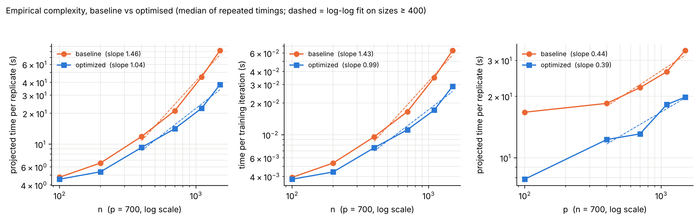
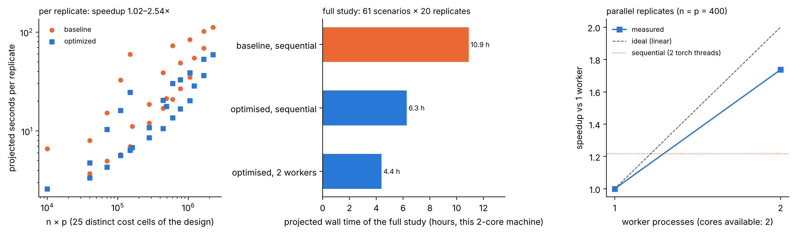

# Optimization

The Unit 2 code is frozen in `src/baseline/`, and the optimised code lives in `src/`. Every number here
comes from `results/perf/` (produced by `make profile complexity benchmark stability-check`)
on the same machine as `docs/BASELINE.md`: 2 CPU cores, 8 GB RAM, CPU PyTorch.

Implemented categories: **algorithmic improvements** (removing redundant work),
**array programming** (broadcasting, restricting computation to the entries that are used),
**numerical stability / memory safeguards**, and **parallelisation** (replicates and scenarios).

## Results at a glance

| measurement (this machine) | baseline | optimised | speedup |
|---|---:|---:|---:|
| training iteration, n = p = 700 | 16.6 ms | 11.1 ms | 1.5× |
| training iteration, n = 1500, p = 700 | 63.5 ms | 28.9 ms | **2.2×** |
| log-log slope of iteration time in n (p = 700, n ≥ 400) | 1.43 | 0.99 | |
| one evaluation call, n = p = 700 | 34.7 ms | 18.0 ms | 1.9× |
| MC estimator (50 draws), n = 1500 | 1.87 s | 1.18 s | 1.6× |
| preprocessing, n = 1500 | 106 ms | 21 ms | 5.0× |
| profiled replicate, n = p = 700, 300 iterations | 5.85 s | 3.69 s | 1.6× |
| **measured** full replicate, n = p = 400, 1,200 iterations | 8.37 s | 6.24 s | 1.34× |
| projected full study, sequential | 10.9 h | 6.3 h | 1.7× |
| projected full study, 2 worker processes (all cores here) | — | 4.4 h | 2.5× vs baseline |
| DGP `RuntimeWarning: overflow` | 262 / 1,220 replicates | 0 | |

The per-replicate speedup grows with n: about 1.0–1.2× at n = 100, where fixed per-iteration overhead
(Python, autograd bookkeeping, Adam's per-tensor loop) dominates, rising to 1.9–2.4× at n = 1500.
This is what removing an O(n²p) term should do. The "projected" rows extrapolate component timings and
are rough. At n = p = 400 the projection gives 1.63× where the end-to-end measurement gives 1.34×, so treat the
full-study rows as approximate. One cell of `benchmark_pairs.csv` (n = p = 100, 2.5×) is an outlier: a
profiling run overlapped that measurement.




---

## 1. Hoist the constant GCN product ·X out of the training loop (algorithmic)

**Problem.** In the profile, `VAE.Q` was the largest self-time entry after autograd's backward
pass (1.00 s of 5.85 s). Each iteration recomputed `AHat @ X_A`, an n_A × n_A by n_A × p
dense product costing O(n_A² p). Neither factor depends on the parameters. This is the only
O(n²p) term in an iteration, so the baseline's per-iteration cost grows like n² at fixed p.
The second GCN propagation `AHat @ h_A` was also computed twice per call, once for μ and once for log σ².

```python
# before (src/baseline/methods.py, every iteration)
h_A    = F.relu((AHat @ X_A) @ self.Q_W1 + self.Q_b1)
z_A_mu = (AHat @ h_A) @ self.Q_W2_mu    + self.Q_b2_mu
z_A_lv = (AHat @ h_A) @ self.Q_W2_sigma + self.Q_b2_sigma
# after (src/methods.py)
t_AX = t_AH @ t_Xf[:n_A]                      # once per replicate, before the loop
...
h_A = F.relu(AX_A @ self.Q_W1 + self.Q_b1)
Ah  = A_hat @ h_A                             # computed once, used twice
mu_A, lv_A = Ah @ self.Q_W2_mu + self.Q_b2_mu, Ah @ self.Q_W2_sigma + self.Q_b2_sigma
```

**Impact.** The per-iteration complexity drops from O(n_A²p + n_A²h + nph) to O(n_A²h + nph).
The fitted log-log slope of training time in n (p = 700) goes from 1.43 to 0.99
(see the figure). **Trade-off:** one more n_A × p tensor is kept in memory, which is negligible.

## 2. Evaluate the decoders only where the loss uses them (algorithmic + array programming)

**Problem.** The baseline decoded X for all n nodes and then kept rows `both ∪ onlyX`. It decoded
edges for all n × n pairs and then kept the n_A × n_A observed block. `PX` and `PA` also returned a
`sigmoid` of the full matrices that was never used, and `neg_elbo` built the upper-triangle mask
with a boolean gather (`nonzero`) on every call. These appear in the profile as `PX`, `PA`,
`torch.sigmoid` and the self time of `neg_elbo` (0.50 s).

```python
# before
_, lgX = model.PX(z_s);  _, lgA = model.PA(z_s)            # n x p and n x n, plus unused sigmoids
lgX_obs = lgX[n_oA:n_oA + n_X];  lgA_obs = lgA[:n_A, :n_A]
BCE(lgA_obs[mask], A_obs[mask])                            # boolean gather every iteration
# after
lgX_obs = F.relu(z_s[n_oA:] @ W1 + b1) @ W2 + b2           # only rows with observed X
z_A = z_s[:n_A]
lgA_up = (z_A @ z_A.t() + b)[iu[0], iu[1]]                 # iu, targets gathered once
BCE(lgA_up, t_Aup)
```

**Impact.** About 30% less work in the X decoder (forward and backward), and the edge decoder
works on 0.49·n² entries instead of n². Together with §1, this gives the per-iteration speedup
reported in the table. **Trade-off:** the training loop no longer calls `model.PX`/`model.PA`,
so the loss is written out inline. The baseline remains as the readable reference.

## 3. Reuse truth-only quantities and restrict evaluation to the needed columns (algorithmic)

**Problem.** Metrics are logged at 25 iterations. Each time, the baseline recomputed
everything that depends only on the truth, for both estimators and all four blocks:
log P, ‖P‖, p̄, KL(P‖p̄), the row norms, and ‖Θ‖. It also formed the n × n estimate, the n × n true-logit
matrix and, for the MC estimator, 50 n × n float64 logit matrices, although every block's
columns lie in the n_A network-observed nodes.

```python
# before: per log, per block, per estimator
logp, log1mp = F.logsigmoid(theta), F.logsigmoid(-theta); kl0 = ...; den = ...
th = z @ z.t() + b                                 # n x n, 50 times for MC
# after
truth = prepare_truth(theta_true_nxnA, blocks)     # once per replicate
th = z @ z[cols].t() + b                           # n x n_A
```

**Impact.** Evaluation calls take 1.9× less time and the MC estimator 1.3× less (n = p = 700).
The four sub-blocks are slices of one n × n_A matrix. **Trade-off:** `evaluate_fast` needs the
precomputed `truth` dictionary, so it has a slightly larger interface than `evaluate`.

## 4. Broadcasting instead of dense diagonal matrices in preprocessing (array programming)

**Problem.** `np.diag(d) @ A @ np.diag(d)` and `np.diag(1/deg) @ A_avg` are O(n_A³) matrix products,
used to scale rows and columns.

```python
# before
data_AHat = np.matmul(np.matmul(np.diag(_DTilde0), _ATilde), np.diag(_DTilde0))
# after
A_hat = d_inv_sqrt[:, None] * A_tilde * d_inv_sqrt[None, :]
```

**Impact.** O(n²) instead of O(n³). Preprocessing becomes 1.75× faster at n = 700, which is small in
absolute terms (Amdahl's law: it runs once per replicate). The result agrees with the baseline to 1e-13.

## 5. Numerical-stability and memory safeguards

* `mc_log_probs` and `plugin_log_probs` now `detach()` their inputs. While timing the baseline estimator
  outside `torch.no_grad()`, the `requires_grad` bias made autograd keep all 50 n × n float64
  intermediates alive, and the process was killed for exceeding 8 GB at n = 1500. The pipeline itself
  calls them under `no_grad`, so Unit 2 was not affected, but the functions are now safe for any caller.
* An optional clamp of the posterior log-variance at ±30 (`MODEL["lv_bound"]`) guards `exp(lv)` against float32
  overflow. `make stability-check` shows |log σ²| never exceeds about 12, so the clamp is the identity
  on every value the study produces (tested), and results do not change.
* The baseline already computed KL and the MC average in log space (`logsigmoid`, running `logaddexp`),
  so they stayed as they were. See `docs/BASELINE.md` for the full audit.

## 6. Parallel replicates and scenarios (parallelisation)

**Problem.** The 1,220 replicates are independent, but the baseline ran them in one process. PyTorch's
intra-op threading on n ≤ 1500 matrices uses extra cores poorly.

**Solution.** `run_all(n_jobs=K)` (`make parallel JOBS=K`) turns every (scenario, replicate) pair into
a joblib process job with 1 torch thread each, so the work is parallel across replicates *and* scenarios.
Each scenario's pickle is written as soon as its 20th replicate returns, so an interrupted run
resumes. Results do not depend on K, because every replicate seeds its own RNGs.
`tests/test_regression.py::test_parallel_equals_sequential` checks bit-for-bit equality.

**Impact.** Eight replicates of n = p = 400 (600 iterations each) on this 2-core machine:

| configuration | wall time | speedup vs 1 worker |
|---|---:|---:|
| sequential, 2 torch intra-op threads (Unit 2 default) | 25.8 s | 1.22× |
| 1 worker × 1 thread | 31.4 s | 1.00× |
| 2 workers × 1 thread | 18.1 s | **1.74×** |

That is 87% parallel efficiency on 2 cores, including worker start-up. The full study is 1,220 independent tasks,
so near-linear scaling should continue on a Great Lakes node. The limits are the slowest
tasks (n = p = 1500, about 1 min each), which bound the tail, and memory (about 1 GB per worker).
`scripts/greatlakes_parallel.sbatch` runs `make parallel` on one 36-core node; I have not run it
for this report.

**Trade-off:** each worker holds its own copy of one replicate's data (≈ 1 GB peak at n = 1500), so
K is limited by memory as well as by cores. Results arrive out of order, and a scenario's log lines interleave with others.

---

## Correctness: do the optimised results match?

`tests/test_regression.py` (run by `make test`) checks three levels:

1. **Components agree to floating-point precision.** Preprocessing agrees to 1e-13. The encoder
   with the precomputed product agrees to 1e-5 in float32. `evaluate_fast` matches `evaluate`, including the MC estimator
   with the same draws, to 1e-10 relative.
2. **Same-seed replicates agree, but not bit-for-bit.** The optimised loop computes mathematically identical
   products on different matrix shapes (for example z_A z_Aᵀ instead of a slice of z zᵀ), so BLAS rounds
   differently. The first logged values differ by about 1e-9 relative. Training is a nonconvex
   1,200-step iteration, so these float32 differences grow, but after a full replicate the final metrics still
   agree to within 2% (observed: at most 0.2% relative in our checks at n = 100). That is far below the between-replicate spread.
3. **Distribution.** Rerunning two cached scenarios with the optimised code (20 replicates each)
   gives final relative KL / Frobenius values whose means lie within 3 standard errors of the
   cached Unit 2 server results, and the KS tests do not reject (p > 0.01). This is the right comparison,
   because the Unit 2 run did not seed torch.

The scientific conclusions in `ANALYSIS.md` are therefore unchanged.

## Lessons learned

* **Best return on investment: hoisting ·X out of the loop (§1).** It is a one-line change, it removes the only
  O(n²p) term, and it is the main source of the 2.2× at n = 1500 (the iteration-time slope in n drops from 1.43 to 0.99;
  I did not time each change in isolation). Parallelising replicates (§6) came second.
  It needed no change to the numerics, scales with the hardware rather than with my code, and is the
  only lever that matters on a cluster.
* **What surprised me.** (i) The expensive parts were not the "statistical" code I expected (the KL
  metrics, the 50-draw MC estimator). They were the autograd backward pass and a constant matrix product
  recomputed 1,200 times per replicate. (ii) Unused work in plain sight: `sigmoid` probabilities computed and
  discarded every iteration, and a boolean-mask gather (`nonzero`) costing 0.5 s per 300 iterations.
  (iii) PyTorch's own two-thread parallelism gave only 1.2×, while two single-threaded processes gave
  1.74×. At these matrix sizes, the coarse-grained level (replicates) is where the parallelism is.
  (iv) At n = 100 nothing helps much (Amdahl's law): the iteration is overhead-bound, not FLOP-bound.
* **Not worth the effort, in hindsight.** Replacing O(n³) diagonal products in preprocessing (§4) is
  5× faster but saves under 0.1% of runtime, because preprocessing runs once per replicate. Precomputing truth-only
  terms in the evaluation (§3) is a modest gain for a larger function interface. Reshaping the matrix
  products also cost something real: bit-for-bit reproducibility against the Unit 2 code. Results now agree
  only to float32 rounding and are validated statistically.
* **Measurement lessons.** Timing is a random variable: one timing per cell plus a background process
  produced at least one misleading cell. My first harness also deadlocked, because it forked worker processes
  after PyTorch had started its OpenMP threads, so `spawn` is needed. And it hit an out-of-memory kill, because it
  called the MC estimator with gradients enabled. Both were bugs in the harness, not in the simulation.
  Both led to safeguards (`spawn` context, `detach()` in the estimators).
